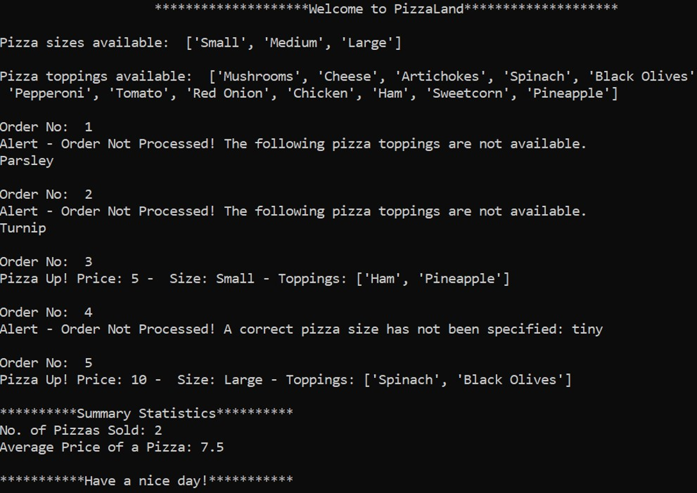
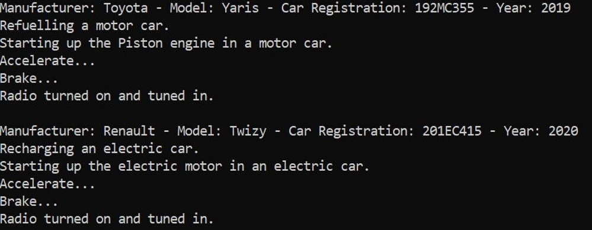

# Topic 3 - OOP – Assignment 
 
## Instructions:   

### Exercise 1:  Pizzas 
Create a simple application to model an ordering system at a pizza restaurant. 
```pizza.py
```
Create a class to model a pizza.  
A pizza should have the following attributes (`price`, `size`, `toppings_requested`).  
Declare the attributes as private.  

The following pizza sizes are available:  Small, Medium, Large.  
If an invalid pizza size is specified, a custom exception (`InvalidPizzaSizeException`) should be raised and handled.  

The following pizza toppings are available at the restaurant: `mushrooms, cheese, artichokes, spinach, black olives, pepperoni, tomato, red onion, chicken, ham, sweetcorn, pineapple`. In an order, if a pizza topping is requested that is not included in this list, a custom exception (`ToppingNotAvailableException`) should be raised and handled.  

A Pizza object should have the following methods:

| Name | Description |
|---|---|
| get_price() | Return the price of a pizza |
| get_size() | Return the size of a pizza |
| eat() | Return ‘Eating a pizza.’ |
| slice() | Return ‘Slicing a pizza.’ |
| take_out_of_box() | Return ‘Take pizza out of box.’ |
| __str__() | Return the attributes of a Pizza object. |

Management at the pizza restaurant are eager to know 
- (a) how many pizzas are sold 
- (b) the average price of a pizza sold. 

Include the relevant attributes and methods in the Pizza class to facilitate the reporting of this data.

`orders.py`
Now it is time to create pizza orders. First, create a variable to store an order number. Before creating a Pizza object, increment the value stored in the variable by one.  
Create the following Pizza objects. The attributes of each pizza object are specified.

|Pizza No:| 	Price| 	Size| 	Toppings Requested| 
|--|---|---|---|
|1 	|10 	|Large 	|Parsley, Sweetcorn |
|2 	|10 	|Large 	|Turnip, Sweetcorn |
|3 	|5 	|Small 	|Ham, Pineapple |
|4 	|5 	|Tiny 	|Ham, Pineapple |
|5 	|10 	|Large 	|Spinach, Black Olives |

A sample execution of the orders.py script is shown below. It shows that some orders were successfully processed, and others were not. Summary information regarding the number of pizzas sold (2) and the average price of a pizza sold (7.5) is also displayed. 



Test each of the methods that you have written in the Pizza class. 

Requirements: 
When writing the Pizza class, ensure that the following are part of the design. 
•	Encapsulation 
•	Variables and methods should be named using the snake_case naming convention. 


===

## Exercise 2:  Cars 
A car has a number of properties including manufacturer, model, car registration and year. 
Assume that there are two types of car (a motor car and an electric car). 
A motor car uses a piston engine. An electric car uses an electric motor. Both an engine and a motor can be started. Assume that all motor cars use the same type of piston engine and that all electric cars use the same type of electric motor. 
A Renault Twizy is an example of an electric car. A Toyota Yaris is an example of a motor car. 
A motor car must be refuelled whereas an electric car must be recharged.  
Cars can accelerate and brake. Assume that these behaviours are the same in both motor cars and electric cars. 
All cars use a standard make of radio. When the user turns on the radio, the following message should be displayed, “Radio turned on and tuned in.” 
Your program output should be like that shown in the screenshot below. 



Requirements: 
- Create classes which you consider are necessary to solve the problem.  
- Apply the OOP design principle of encapsulation to your classes. 
- Hint: You may wish to incorporate composition in your solution. Composition is one of the fundamental concepts in object-oriented programming. It describes a class that references one or more objects of other classes in instance variables.  
- Create some objects from the classes that you have created and test your understanding of the program outputs. 
- Variables and methods should be named using the snake_case naming convention. 
